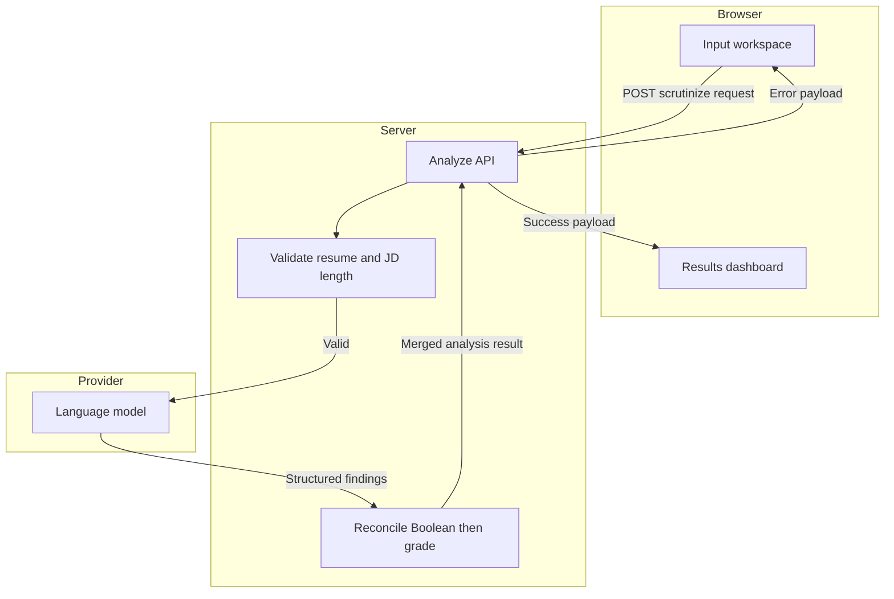
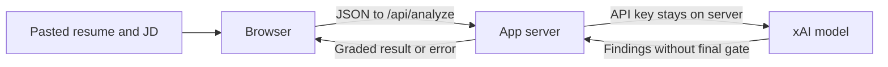
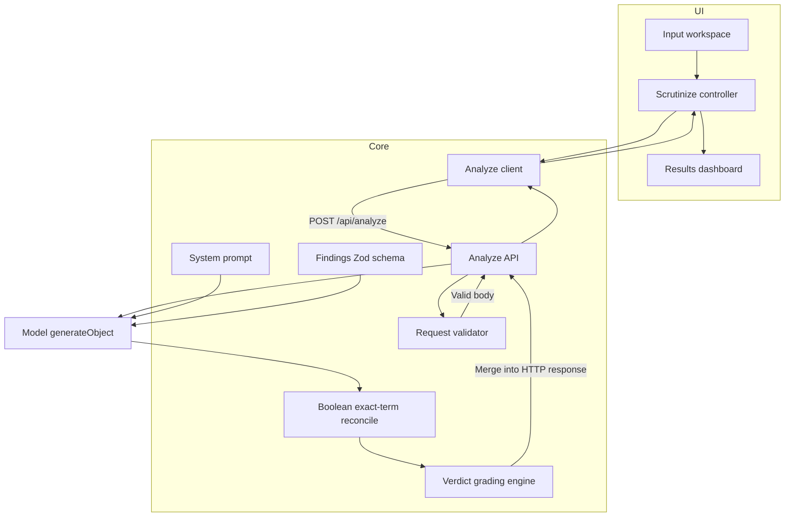
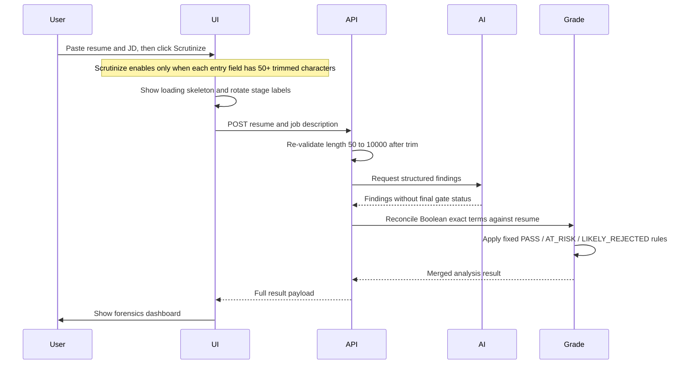
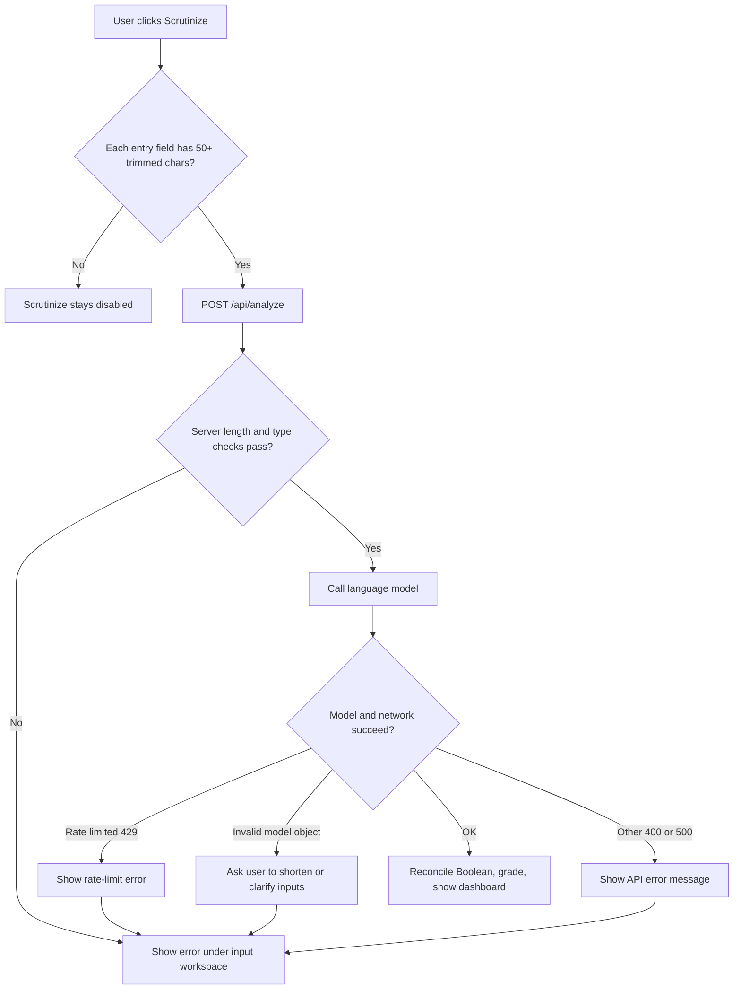
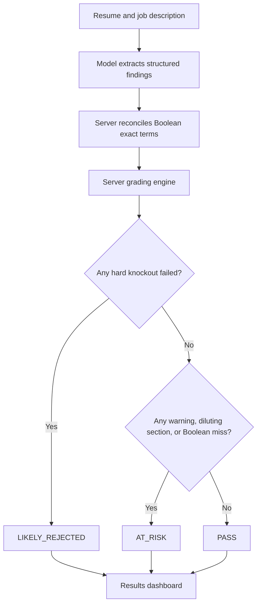
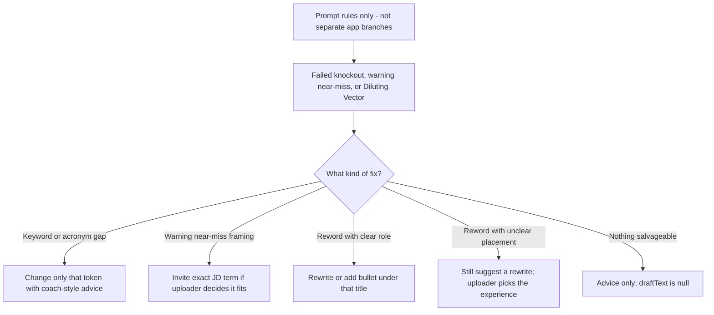
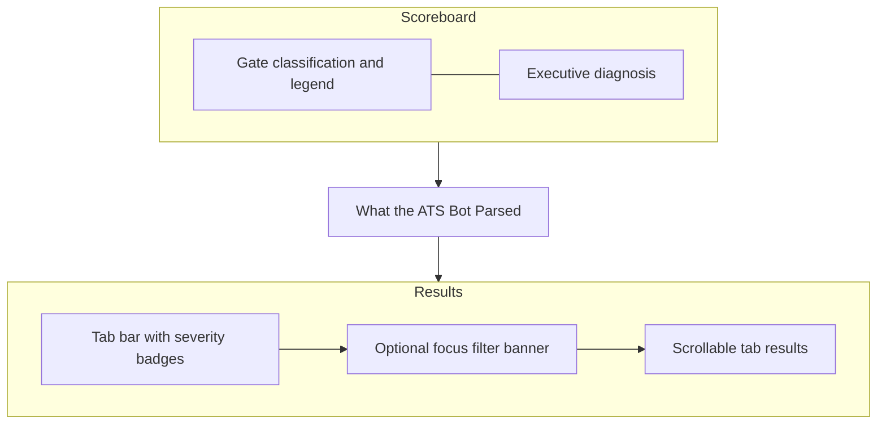

# CVScrutineer — AI Spec

Product-friendly overview of how the AI analysis works, how the system is put together, and how data moves through the product.

This document describes **what is implemented today**. Where behavior depends on the model following instructions (for example Fix-it wording), that is called out as a **prompt rule**, not as a hard guarantee enforced after the fact. **Recruiter Boolean exact-term matching** is an exception: the server re-checks query terms against the resume after the model responds.

**Diagrams in Cursor:** the built-in Markdown **Open Preview** tab has a limited Mermaid engine. For reliable flowchart/sequence rendering, install the **Markdown Preview Mermaid Support** extension (`bierner.markdown-mermaid`), open the `.md` **Source** tab, then run **Markdown: Open Preview to the Side** (`Cmd+K` then `V`). GitHub also renders these blocks natively.

---

## 1. What problem does the AI solve?

Recruiters and job seekers often don’t know **why** a resume never reaches a human. Filters can reject people for missing keywords, weak seniority language, or unrelated experience that “dilutes” the match.

CVScrutineer’s AI looks at:

1. The **resume** (pasted as text)
2. The **job description** (pasted as text)

…and explains what an ATS / recruiter search would likely flag—and what the candidate could change.

It is **designed not** to invent fake skills, fake metrics, or a made-up “match percentage” (via prompt + output contract; see §6).

---

## 2. What the user gets back

| Area | In plain English | Where it appears |
| --- | --- | --- |
| **Gate classification** | Overall status: likely rejected, at risk, or pass | Scoreboard (beside executive diagnosis on wide layouts; above it when stacked) |
| **Executive diagnosis** | Summary of the main pass/fail reason (prompt asks for two sentences; app does not re-check length) | Scoreboard (beside gate on wide layouts; under gate when stacked) |
| **ATS parse summary** | Detected title, relevant years, seniority, parser warnings | Scoreboard (full width under gate + diagnosis) |
| **Knockout rules** | Must-have JD requirements: met, warning, or failed | **Knockout Filters** tab |
| **Vector drift** | Which resume sections help vs. hurt the match | **Vector Drift Map** tab |
| **Recruiter Boolean search** | Sample searches and Would Match vs Filtered Out (exact terms only; e.g. TypeScript ≠ TS) | **Recruiter Search Test** tab |
| **Fix-it tips** | Advice + optional copy-ready suggestion | Under failed/warning knockouts and Diluting Vector rows |

---

## 3. System architecture (big picture)

The product has three layers:

1. **Browser (UI)** — paste inputs, show loading, show the forensics dashboard  
2. **App server (analysis API)** — validates input, calls the model, reconciles Boolean exact terms, applies the final grade  
3. **AI provider (xAI)** — reads resume + JD and returns structured findings without the final gate  

### Trust boundary (simple)

- The AI API key never goes to the browser.
- **Scrutinize** stays disabled until **each entry field** (resume and job description) has at least **50** trimmed characters. The UI also caps each field at **9,500** characters.
- The server re-validates both strings at **50–10,000** characters (after trim) before calling the model.
- Boolean Would Match / Filtered Out is re-checked on the server with **exact** resume terms; the final gate label is also calculated **on our server**, not by the model.

---

## 4. Module design

Think of the AI path as a few cooperating modules. Each has one job.

| Module | What it does (plain English) | Why it exists |
| --- | --- | --- |
| **Input workspace** | Collects resume + JD text; sample load / clear; shows API errors | Keeps input separate from results |
| **Scrutinize controller** | Starts analysis, rotates loading messages, tracks success/error; aborts an in-flight request if a new run starts or results are cleared | Owns the “run analysis” experience |
| **Analyze client** | Sends the request to the server and checks the reply looks valid | Protects the UI from broken payloads |
| **Analyze API** | Server entry point for one analysis run | Single place for secrets and AI calls |
| **Request validator** | Confirms both entry fields are strings within 50–10,000 trimmed characters | Avoids wasted model calls and bad input |
| **AI instructions** | Rules the model must follow (grounding, Fix-it format, no fake scores) | Keeps AI behavior consistent |
| **Findings contract** | Defines the exact fields the AI must return | Makes results predictable for the UI |
| **Boolean exact-term reconcile** | Re-evaluates each recruiter Boolean query against the resume with exact string matching | Stops false Would Match when only near-miss acronyms exist (TypeScript vs TS) |
| **Verdict / grading engine** | Turns reconciled findings into PASS / AT_RISK / LIKELY_REJECTED plus counts | Repeatable, explainable final gate status |
| **Results dashboard** | Shows scoreboard + knockout / drift / recruiter tabs | Turns findings into something humans can use |

**Note:** Loading stage messages (knockouts → drift → Boolean) are **cosmetic progress text**. They rotate while waiting; they are not separate AI steps.

### What the AI produces vs. what the app adds

| Produced by AI | Added by app (not AI) |
| --- | --- |
| Executive diagnosis | Final gate status (`knockoutStatus`) |
| ATS parse profile | Metric counts + classification sentence (`verdictBreakdown`) |
| Knockout rules + Fix-its (failed and warning near-misses) | — |
| Drift audit + Fix-its (when diluting) | — |
| Recruiter Boolean query strings | Exact-term reconcile (`wouldMatch` / `missingExactTerm`; e.g. TypeScript ≠ TS) |

---

## 5. Core flows

### 5.1 Happy path — “Scrutinize Resume”

### 5.2 Error path (as implemented)

On error, the results pane returns to the empty-state CTA; the error string from the API (or a client fallback) appears under the input fields. There is no separate Cancel control during loading; starting a new run or clearing aborts an in-flight request.

### 5.3 AI finds → app reconciles Boolean → app grades

Boolean reconcile and the decision diamonds above are **server rules**, not choices made by the language model.

| Status | Meaning |
| --- | --- |
| **LIKELY_REJECTED** | At least one hard “must-have” failed |
| **AT_RISK** | No hard fails, but warnings, diluting sections, and/or Boolean misses |
| **PASS** | No hard fails, **no warnings**, no diluting sections, and every Boolean query would match (exact terms) |

**Why separate AI and grading?**

- AI is strong at reading and explaining text.
- Fixed rules make the final status consistent and easy to defend in reviews.

---

## 6. How the AI is supposed to behave

Most grounding rules are enforced by the **system prompt** and **output contract**. One exception is **recruiter Boolean coverage**: after the model returns queries, the server re-checks each required term against the resume with **exact** matching (so `TypeScript` does not match `TS` / `JS/TS`, and the reverse). Fix-it wording is still a prompt rule, not a post-hoc rewrite of every suggestion.

### Always (prompt / contract intent)

- Base answers on the pasted resume and job description
- Point to real evidence (or clear gaps)
- Keep suggestions grounded in what the candidate already wrote
- Treat Boolean terms as exact strings (prompt); the server re-verifies them

### Never (prompt / contract intent)

- Invent employers, tools, numbers, or experience that aren’t on the resume
- Invent a score like “87% match”
- Decide the final Pass / At Risk / Rejected label by itself
- Treat near-miss acronyms as Boolean hits (e.g. `TS` for `TypeScript`)

---

## 7. Fix-it suggestions

Each Fix-it has two parts in the data model:

1. **Advice** — short explanation of what to change and why  
2. **Suggestion (`draftText`)** — optional paste-ready text; set to **`null`** when the tip is advice-only (e.g. remove / collapse)

**UI behavior (implemented):**

- Renders a Fix-it block when the row qualifies (failed or warning knockout, or Diluting Vector) and advice is non-empty
- Shows a **Suggestions** box + **Copy** only when `draftText` is a non-empty string
- Under **Suggestions**, shows a short caveat: paste only if it matches work you have actually done
- **Copy** pastes the suggestion text, not the advice

**How the AI should write suggestions (prompt rules, not a separate app branch):**

These branches describe **how the model is instructed to write Fix-its**, not separate code paths in the app.

### Keyword swaps (example: `TS` → `TypeScript`)

- Keep the original resume line
- Change **only** that word/acronym
- Do **not** rewrite the rest of the sentence
- Advice should sound like natural coaching (what/where/why), not a disclaimer template; the UI caveat covers “paste only if true”

### Bigger edits

- Still based on a real resume section (prefer skills line, bullet, or summary)
- Keep the same employer / role / facts
- Prefer JD-relevant language already on the resume
- Do **not** rewrite Title — Company headers by stuffing JD jargon into the title (e.g. avoid “Product Manager (0-1 Growth Initiatives) — Northstar Commerce”)
- If scope/domain wording belongs with a role and placement is clear, put it in a suggested bullet under that title (rewrite an existing bullet or draft a new one grounded in facts already evidenced for that role)
- Write advice as a helpful coach for the uploader: short, direct, concrete—no mid-sentence “e.g. …” hedges, no rigid “If you have…, add… to…” formula, no “leave it as is” endings
- Missing / near-miss skill example: “Spell out TypeScript on your Skills line—recruiters search the full word, not JS/TS.”
- Near-miss framing with a cue: “Your new checkout upsell module bullet is close to what they call 0-to-1. Check if 0-to-1 actually suits your experience, and if you decide that it does, rewrite it with that term and keep all the other facts the same.”
- Placement unclear: “Check which experience truly fits 0-to-1 for you; if one does, rewrite that bullet to include the term while keeping your facts.”
- Read resume text deeply for near-miss cues (“new product release” / “checkout upsell” ↔ “0-to-1”); the uploader decides applicability—never invent experience
- Suggest removal only when the section can’t be salvaged

---

## 8. Dashboard information architecture

After a successful run, layout is:

Also implemented:

- Non-zero gate metric tiles jump to the matching tab and open a filter banner (**Clear** resets the filter).
- **Met knockouts** and **High Signal sections** stay collapsed by default.
- When the results list overflows, a **Scroll for more** cue can appear.
- On narrow viewports, results sit above the input workspace; on wide layouts they sit side by side.

---

## 9. Privacy & trust

- Pasted text is sent for analysis to the AI provider
- There is **no** automatic “scrub personal info” step today
- Users should avoid pasting secrets or data they shouldn’t share
- The product is designed **not** to invent candidate achievements (via prompt/contract)
- API credentials stay on the server only

---

## 10. What this AI module is *not*

- Not a file/PDF uploader (text paste only)
- Not a guarantee of getting hired or passing every ATS
- Not a numeric ranking score
- Not a history of past analyses (no accounts / saved runs yet)
- Not a post-hoc validator that diffs every Fix-it suggestion against the resume byte-for-byte (Boolean exact-term reconcile is the exception)

---

## 11. Success criteria

Manual quality bar for reviewing AI runs (not automated checks in the app):

**Good run**

- Names the main reason the resume is at risk or rejected
- Lists real JD must-haves with clear pass / warn / fail
- Calls out diluting sections honestly
- Offers Fix-its a candidate could paste without inventing experience (including warning near-misses where the uploader must decide if a JD term fits)
- For simple keyword fixes, changes only the missing word
- Boolean Would Match / Filtered Out follows exact terms typed in the query (TypeScript ≠ TS)

**Bad run**

- Invents skills or metrics
- Shows a fake percentage score
- Suggests a rewrite that no longer matches the original resume facts
- Marks Boolean Would Match when only a near-miss acronym is on the resume

---

## 12. Related docs

- **README.md** — how to use the product and run it locally
- Implementation lives in the codebase (API route, schemas, grading logic, UI)
