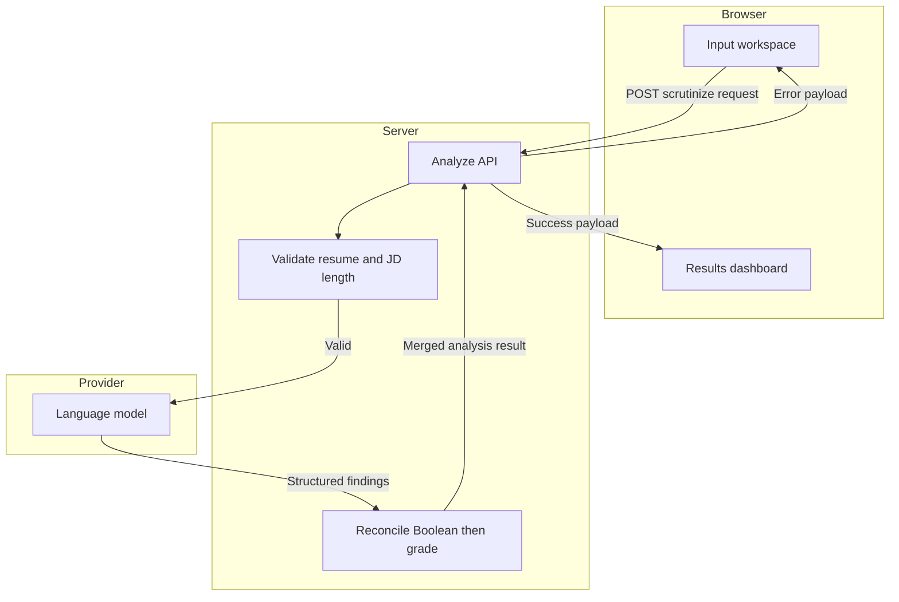
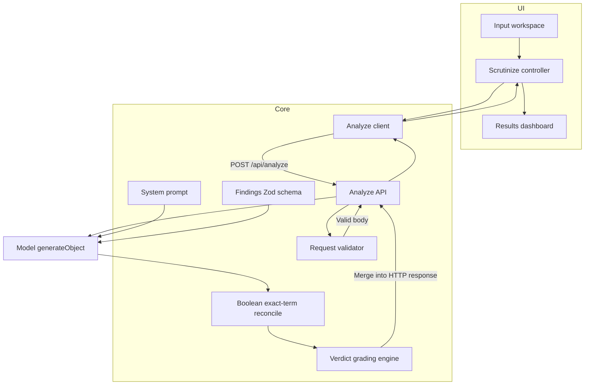
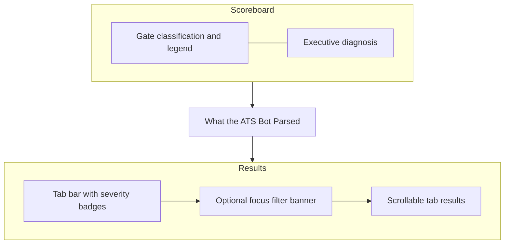
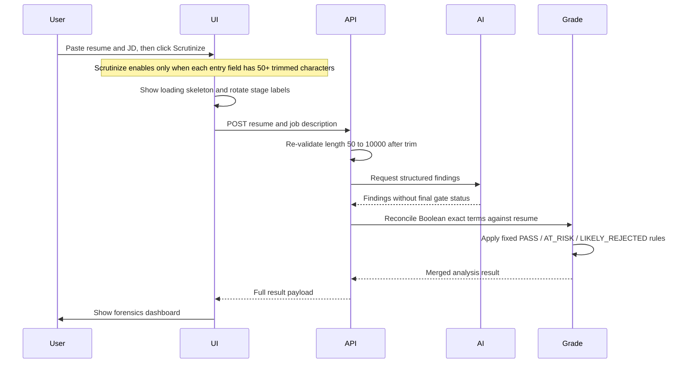
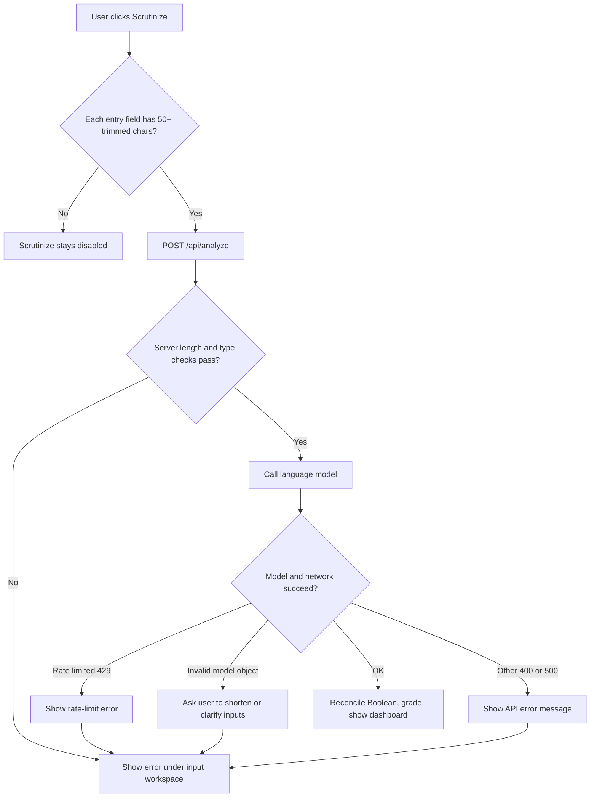
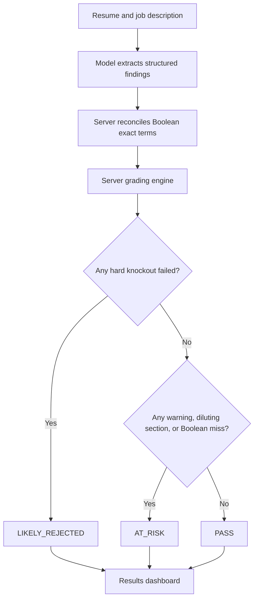
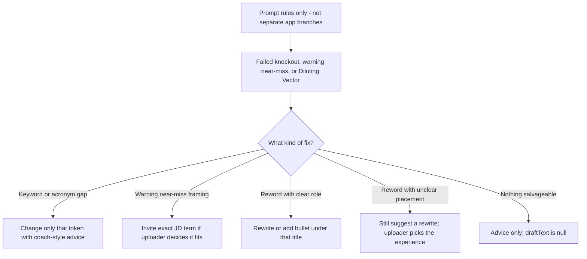
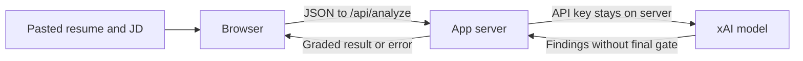

# CVScrutineer — AI Spec

Product-friendly overview of how the AI analysis works, how the system is put together, and how data moves through the product.

This document describes **what is implemented today**. Where behavior depends on the model following instructions (for example Fix-it wording), that is called out as a **prompt rule**, not as a hard guarantee enforced after the fact. **Recruiter Boolean exact-term matching** is an exception: the server re-checks query terms against the resume after the model responds (case-insensitive token/phrase match with alphanumeric boundaries—not raw substring matching; see §3).

**Diagrams in Cursor:** the built-in Markdown **Open Preview** tab has a limited Mermaid engine. For reliable flowchart/sequence rendering, install the **Markdown Preview Mermaid Support** extension (`bierner.markdown-mermaid`), open the `.md` **Source** tab, then run **Markdown: Open Preview to the Side** (`Cmd+K` then `V`). GitHub also renders these blocks natively.

| Spec map | Section |
| --- | --- |
| Context & Goal | [§1](#1-context--goal) |
| Inputs & Outputs | [§2](#2-inputs--outputs) |
| Behavior Rules | [§3](#3-behavior-rules) |
| Constraints | [§4](#4-constraints) |
| Acceptance Criteria | [§5](#5-acceptance-criteria) |

---

## 1. Context & Goal

CVScrutineer is a web tool for people applying to jobs (and anyone coaching them). It takes a pasted resume and job description, then shows what automated screening and recruiter keyword searches would likely flag—and what the candidate could change—so they can see why a resume might never reach a human, without inventing skills, metrics, or a made-up match percentage.

### System layers

1. **Browser (UI)** — paste inputs, show loading, show the forensics dashboard  
2. **App server (analysis API)** — validates input, calls the model, reconciles Boolean exact terms, applies the final grade  
3. **AI provider (xAI)** — reads resume + JD and returns structured findings without the final gate  



### Module design

Think of the AI path as a few cooperating modules. Each has one job.



| Module | What it does (plain English) | Why it exists |
| --- | --- | --- |
| **Input workspace** | Collects resume + JD text; sample load / clear; shows API errors | Keeps input separate from results |
| **Scrutinize controller** | Starts analysis, rotates loading messages, tracks success/error; no Cancel—Clear / Scrutinize / samples stay disabled while loading | Owns the “run analysis” experience |
| **Analyze client** | Sends the request to the server and checks the reply looks valid | Protects the UI from broken payloads |
| **Analyze API** | Server entry point for one analysis run | Single place for secrets and AI calls |
| **Request validator** | Confirms both entry fields are strings within 50–10,000 trimmed characters | Avoids wasted model calls and bad input |
| **AI instructions** | Rules the model must follow (grounding, Fix-it format, no fake scores) | Keeps AI behavior consistent |
| **Findings contract** | Defines the exact fields the AI must return | Makes results predictable for the UI |
| **Boolean exact-term reconcile** | Re-evaluates each recruiter Boolean query against the resume with case-insensitive alphanumeric-boundary token/phrase matching (after AND/OR/paren/quote parse) | Stops false Would Match when only near-miss acronyms exist (TypeScript vs TS); `React` ≠ inside `Reactive` |
| **Verdict / grading engine** | Turns reconciled findings into PASS / AT_RISK / LIKELY_REJECTED plus counts | Repeatable, explainable final gate status |
| **Results dashboard** | Shows scoreboard + knockout / drift / recruiter tabs | Turns findings into something humans can use |

**Note:** Loading stage messages (knockouts → drift → Boolean) are **cosmetic progress text**. They rotate while waiting; they are not separate AI steps.

### Out of scope

- Not a file/PDF uploader (text paste only)
- Not a guarantee of getting hired or passing every ATS
- Not a numeric ranking score
- Not a history of past analyses (no accounts / saved runs yet)
- Not a post-hoc validator that diffs every Fix-it suggestion against the resume byte-for-byte (Boolean exact-term reconcile is the exception)

---

## 2. Inputs & Outputs

### Inputs

| Input | Form | Notes |
| --- | --- | --- |
| **Resume** | Plain text paste | Sample presets available; no file upload |
| **Job description** | Plain text paste | Same length rules as resume |

Request shape to `/api/analyze`: JSON `{ resume, jobDescription }`.

### Data types, shapes, and formats

Canonical contracts live in Zod (`src/lib/validateAnalyzeRequest.ts`, `src/lib/schemas/analysis.ts`). Types are inferred from those schemas—not hand-written duplicates.

#### Request — `POST /api/analyze`

| Field | Type | Format / limits |
| --- | --- | --- |
| `Content-Type` | header | `application/json` |
| `resume` | `string` | Trimmed plain text; **50–10,000** chars after trim |
| `jobDescription` | `string` | Same as `resume` |

```json
{ "resume": "<plain text>", "jobDescription": "<plain text>" }
```

Invalid body → HTTP `400` with `{ "error": "<string>" }`. Rate limits → `429` with the same error shape. Server failures → `500` with `{ "error": "<string>" }`.

#### Fix-it object — `FixItSuggestion`

| Field | Type | Expected format |
| --- | --- | --- |
| `advice` | `string` | Coach-style guidance shown in the UI (not what Copy pastes) |
| `draftText` | `string \| null` | Paste-ready resume fragment, or `null` for advice-only (e.g. remove) |

#### AI findings (before grading) — `AnalysisFindings`

| Field | Type | Expected format |
| --- | --- | --- |
| `executiveSummary` | `string` | Plain-English diagnosis (prompt asks for ~2 sentences) |
| `atsParsedProfile` | object | See below |
| `knockoutRules` | array of objects | JD must-haves with status + optional Fix-it |
| `semanticDriftAudit` | array of objects | Per resume section / role |
| `recruiterSearchQueries` | array of objects | Sample Boolean queries + match flags |

**`atsParsedProfile`**

| Field | Type | Allowed values / format |
| --- | --- | --- |
| `detectedPrimaryTitle` | `string` | Title inferred from the resume |
| `calculatedRelevantYears` | `number` | Relevant years of experience |
| `seniorityClassification` | enum string | `Junior` \| `Mid-Level` \| `Senior` \| `Staff/Lead` \| `Unclear` |
| `parserWarnings` | `string[]` | Human-readable parse issues |

**Each `knockoutRules[]` item**

| Field | Type | Allowed values / format |
| --- | --- | --- |
| `rule` | `string` | Must-have requirement from the JD |
| `category` | enum string | `Experience & Seniority` \| `Core Tech / Domain` \| `Ownership & Scope` \| `Logistics / Constraints` |
| `status` | enum string | `met` \| `warning` \| `failed` |
| `evidenceOrGap` | `string` | Quote or gap explanation |
| `fixItSuggestion` | `FixItSuggestion \| null` | Required intent for `failed` / `warning`; `null` when `met` |

**Each `semanticDriftAudit[]` item**

| Field | Type | Allowed values / format |
| --- | --- | --- |
| `resumeSectionOrRole` | `string` | Role, project, or section label |
| `driftDiagnosis` | enum string | `High Signal` \| `Neutral` \| `Diluting Vector` |
| `actionAdvice` | `string` | Expand / keep concise / reword / remove |
| `fixItSuggestion` | `FixItSuggestion \| null` | Set for `Diluting Vector`; `null` for High Signal / Neutral |

**Each `recruiterSearchQueries[]` item**

| Field | Type | Allowed values / format |
| --- | --- | --- |
| `booleanQuery` | `string` | Recruiter-style Boolean, e.g. `"React" AND "TypeScript"` |
| `wouldMatch` | `boolean` | **Server-reconciled** result (overwrites the model); see §3 Boolean reconcile |
| `missingExactTerm` | `string \| null` | First missing required term when filtered out; else `null` |

#### Success response — `AnalysisResult`

Everything in `AnalysisFindings`, plus app-added fields:

| Field | Type | Allowed values / format |
| --- | --- | --- |
| `knockoutStatus` | enum string | `PASS` \| `AT_RISK` \| `LIKELY_REJECTED` |
| `verdictBreakdown` | object | Counts + human-readable rule string |

**`verdictBreakdown`**

| Field | Type | Format |
| --- | --- | --- |
| `failedKnockoutCount` | `number` (int ≥ 0) | Count of `failed` knockouts |
| `warningKnockoutCount` | `number` (int ≥ 0) | Count of `warning` knockouts |
| `dilutingSectionCount` | `number` (int ≥ 0) | Count of `Diluting Vector` rows |
| `missedBooleanCount` | `number` (int ≥ 0) | Count of Boolean queries with `wouldMatch: false` |
| `classificationRule` | `string` | Plain-English explanation of the gate label |

#### Error response

```json
{ "error": "<human-readable string>" }
```

### Outputs (what the user gets back)

| Area | In plain English | Where it appears |
| --- | --- | --- |
| **Gate classification** | Overall status: `LIKELY_REJECTED`, `AT_RISK`, or `PASS` | Scoreboard (beside executive diagnosis on wide layouts; above it when stacked) |
| **Executive diagnosis** | Summary of the main pass/fail reason (prompt asks for two sentences; app does not re-check length) | Scoreboard (beside gate on wide layouts; under gate when stacked) |
| **ATS parse summary** | Detected title, relevant years, seniority, parser warnings | Scoreboard (full width under gate + diagnosis) |
| **Knockout rules** | Must-have JD requirements: met, warning, or failed | **Knockout Filters** tab (short label **Knockouts** below `sm`) |
| **Vector drift** | Which resume sections help vs. hurt the match | **Vector Drift Map** tab (short label **Drift** below `sm`) |
| **Recruiter Boolean search** | Sample searches and Would Match vs Filtered Out (server token match; e.g. TypeScript ≠ TS) | **Recruiter Search Test** tab (short label **Boolean** below `sm`) |
| **Fix-it tips** | Advice + optional copy-ready suggestion | Under failed/warning knockouts and Diluting Vector rows |

### What the AI produces vs. what the app adds

| Produced by AI | Added by app (not AI) |
| --- | --- |
| Executive diagnosis | Final gate status (`knockoutStatus`) |
| ATS parse profile | Metric counts + classification sentence (`verdictBreakdown`) |
| Knockout rules + Fix-its (failed and warning near-misses) | — |
| Drift audit + Fix-its (when diluting) | — |
| Recruiter Boolean query strings | Boolean reconcile (`wouldMatch` / `missingExactTerm`; case-insensitive boundary match; e.g. TypeScript ≠ TS) |

### Fix-it UI behavior

Schema fields are under **Data types** (`FixItSuggestion`). In the UI:

- Renders a Fix-it block when the row qualifies (failed or warning knockout, or Diluting Vector) and advice is non-empty
- Shows a **Suggestions** box + **Copy** only when `draftText` is a non-empty string
- Under **Suggestions**, shows a short caveat: paste only if it matches work you have actually done
- **Copy** pastes the suggestion text, not the advice

### Dashboard layout (after a successful run)



Also implemented:

- Non-zero gate metric tiles jump to the matching tab and open a filter banner (**Clear** resets the filter).
- **Met knockouts** and **High Signal sections** stay collapsed by default.
- When the results list overflows, a **Scroll for more** cue can appear.
- On narrow viewports, results sit above the input workspace; on wide layouts they sit side by side.

---

## 3. Behavior Rules

### Happy path — “Scrutinize Resume”



### Error path (as implemented)



On error, the results pane returns to the empty-state CTA; the error string from the API (or a client fallback) appears under the input fields. There is no Cancel control. While loading, Clear / Scrutinize / sample buttons are disabled, so an in-flight request is **not** user-abortable. An `AbortController` still runs when starting a new run or clearing results (race cleanup once those actions are available again).

### AI finds → app reconciles Boolean → app grades



Boolean reconcile and the decision diamonds above are **server rules**, not choices made by the language model.

| Status | Meaning |
| --- | --- |
| **LIKELY_REJECTED** | At least one hard “must-have” failed |
| **AT_RISK** | No hard fails, but warnings, diluting sections, and/or Boolean misses |
| **PASS** | No hard fails, **no warnings**, no diluting sections, and every Boolean query would match (server term rules) |

### Boolean exact-term reconcile (server)

Implemented in `src/lib/booleanMatch.ts`. After the model returns `recruiterSearchQueries`, the server overwrites each `wouldMatch` / `missingExactTerm`.

1. **Parse** the query into AND-groups of OR alternatives (top-level `AND` / `OR`, unwrap parens, extract quoted or bare tokens).
2. **Match** each required term with a **case-insensitive** regex that requires **alphanumeric boundaries** on both sides—token/phrase match, **not** a raw substring.
3. A query **would match** only when every AND-group has at least one alternative present in the resume.

| Example | Result |
| --- | --- |
| Query needs `TypeScript`; resume has only `TS` / `JS/TS` | No match (`TypeScript` ≠ `TS`) |
| Query needs `TypeScript`; resume has `typescript` | Match (case-insensitive) |
| Query needs `React`; resume has `Reactive` | No match (boundary: not a raw substring) |
| `"React" AND ("TypeScript" OR "TS")` with resume containing React + TypeScript | Match |

**Why separate AI and grading?**

- AI is strong at reading and explaining text.
- Fixed rules make the final status consistent and easy to defend in reviews.

### How the AI is supposed to behave

Most grounding rules are enforced by the **system prompt** and **output contract**. One exception is **recruiter Boolean coverage**: after the model returns queries, the server re-checks terms as above (so `TypeScript` does not match `TS` / `JS/TS`, and the reverse). Fix-it wording is still a prompt rule, not a post-hoc rewrite of every suggestion.

**Enforcement boundaries**

- Fix-it wording and most grounding rules are **prompt / contract intent**, not a byte-for-byte post-hoc rewrite of every suggestion
- Knockout rule statuses (`met` / `warning` / `failed`) come from the model; the app uses them in grading counts without re-litigating each one
- Boolean Would Match / Filtered Out and the final gate label are **server-enforced** (see Boolean reconcile and grading above)

#### Always (prompt / contract intent)

- Base answers on the pasted resume and job description
- Point to real evidence (or clear gaps)
- Keep suggestions grounded in what the candidate already wrote
- Treat Boolean terms as distinct tokens in the prompt; the server re-verifies with the rules above

#### Never (prompt / contract intent)

- Invent employers, tools, numbers, or experience that aren’t on the resume
- Invent a score like “87% match”
- Decide the final Pass / At Risk / Rejected label by itself
- Treat near-miss acronyms as Boolean hits (e.g. `TS` for `TypeScript`)

### Fix-it writing rules (prompt only)



These branches describe **how the model is instructed to write Fix-its**, not separate code paths in the app.

#### Coach voice (all Fix-its)

- Write advice as a helpful coach for the uploader: short, direct, concrete
- No mid-sentence “e.g. …” hedges, no rigid “If you have…, add… to…” formula, no “leave it as is” endings
- The UI caveat covers “paste only if true”

#### Keyword swaps (example: `TS` → `TypeScript`)

- Keep the original resume line
- Change **only** that word/acronym
- Do **not** rewrite the rest of the sentence
- Example: “Spell out TypeScript on your Skills line—recruiters search the full word, not JS/TS.”

#### Warning near-miss / framing

- Read resume text deeply for near-miss cues (“new product release” / “checkout upsell” ↔ “0-to-1”); the uploader decides applicability—never invent experience
- Near-miss framing with a cue: “Your new checkout upsell module bullet is close to what they call 0-to-1. Check if 0-to-1 actually suits your experience, and if you decide that it does, rewrite it with that term and keep all the other facts the same.”
- Placement unclear: “Check which experience truly fits 0-to-1 for you; if one does, rewrite that bullet to include the term while keeping your facts.”

#### Bigger edits (rewrites / placement / removal)

- Still based on a real resume section (prefer skills line, bullet, or summary)
- Keep the same employer / role / facts
- Prefer JD-relevant language already on the resume
- Do **not** rewrite Title — Company headers by stuffing JD jargon into the title (e.g. avoid “Product Manager (0-1 Growth Initiatives) — Northstar Commerce”)
- If scope/domain wording belongs with a role and placement is clear, put it in a suggested bullet under that title (rewrite an existing bullet or draft a new one grounded in facts already evidenced for that role)
- Suggest removal only when the section can’t be salvaged (`draftText: null`)

---

## 4. Constraints

### Tech stack

| Layer | Use |
| --- | --- |
| Runtime | **Node.js ≥ 22** (`engines.node`) |
| App framework | **Next.js 16** (App Router) |
| UI | **React 19**, **Tailwind CSS 4**, **lucide-react** icons |
| Validation / types | **Zod 4**; TypeScript types via `z.infer` |
| AI | **Vercel AI SDK** (`ai`) + **`@ai-sdk/xai`** (xAI models) |
| Tests | **Vitest** (Node environment; no jsdom) |
| Lint / check | ESLint (`eslint-config-next`), `npm run typecheck` (`next typegen` + `tsc --noEmit`), `check:lines` |

### Dependencies & integration patterns

**Use**

- Zod schemas as the single source of truth for request/response shapes
- Server-only AI SDK calls from the App Router API route (`ai` + `@ai-sdk/xai`)
- Existing shared utilities (`validateAnalyzeRequest`, `booleanMatch`, `deriveVerdict`, analyze client)

**Do not add / do not use**

- **jsdom** (or similar browser DOM test harnesses that pull fragile undici setups into Node tests)
- **PDF / file-upload** libraries for resume ingest (text paste only, by design)
- Client-side SDKs that would expose the AI provider key (keep calls on the server; see Security)

TypeScript escape hatches (`any`, `@ts-ignore`, unvalidated `as`) and hand-written types that drift from Zod belong under **Coding style**. Secrets handling belongs under **Security**.

### Input & runtime limits

- **Input size:** UI soft-cap **9,500** chars per field; server hard-cap **10,000** after trim; minimum **50** trimmed chars each before analyze
- **Scrutinize** stays disabled until both fields meet the 50-character floor
- Loading stage labels are cosmetic rotation only—not separate model round-trips
- Concurrent UX while loading (disabled controls / no Cancel) is under §3 Error path

### Security requirements



- Validate every `/api/analyze` body for type, presence, and length **before** calling the model; return `{ error: string }` with `400`, `429`, or `500` as appropriate
- Keep `XAI_API_KEY` server-side only (`process.env`—never hardcode secrets in source)
- Pasted text is sent to the AI provider; there is **no** automatic PII scrub today—users should not paste secrets
- Ground model outputs in user-provided text (prompt + schema); do not invent achievements or numeric match scores
- Boolean reconcile and final gate labeling are server-side (enforcement details in §3)

### Coding style

Aligned with `.cursorrules`:

- **Strict TypeScript:** `strict`, `noUncheckedIndexedAccess`, `noImplicitAny`; handle `null` / `undefined` on lookups
- **No escape hatches:** never use `any`, `@ts-ignore`, `@ts-expect-error`, or unvalidated `as` casts
- **Types from Zod:** `z.infer<typeof Schema>` only—no drifting hand types
- **File size:** no `.ts` / `.tsx` source file over **250** lines (tests and static fixtures excluded); split at ~200+ lines into components, hooks, schemas, or utils
- **Tests:** every utility, schema, and validator has Vitest coverage for normal, boundary, and invalid cases; update tests in the same change as logic
- **DoD before ship:** `npm run check:lines`, `npm run typecheck`, `npm run lint`, `npm test`, `npm run build`

---


## 5. Acceptance Criteria

Only conditions covered by Vitest unit tests and/or `.github/workflows/ci.yml`. UI rendering and live-model output quality are described elsewhere in this spec but are not acceptance criteria here.

### Input & API

1. **Given** a non-object body, non-string fields, or resume/JD strings outside 50–10,000 trimmed characters, **when** `validateAnalyzeRequest` runs, **then** it returns `{ ok: false, error: string }` (`validateAnalyzeRequest.test.ts`).
2. **Given** a successful JSON analysis payload, **when** `analyzeResume` runs, **then** it returns a value that parses as `AnalysisResult` (findings + `knockoutStatus` + `verdictBreakdown`); **given** a non-OK response with `{ error }`, **when** `analyzeResume` runs, **then** it throws `AnalyzeClientError` with that message (`analyzeClient.test.ts`).

### Grading & Boolean reconcile (server)

3. **Given** findings that include at least one knockout with `status: "failed"`, **when** `deriveVerdict` runs, **then** `knockoutStatus` is `LIKELY_REJECTED` (`deriveVerdict.test.ts`).
4. **Given** no failed knockouts, but at least one warning knockout, Diluting Vector, or Boolean miss, **when** `deriveVerdict` runs, **then** `knockoutStatus` is `AT_RISK` (`deriveVerdict.test.ts`).
5. **Given** no failed knockouts, no warnings, no Diluting Vectors, and every Boolean query matches, **when** `deriveVerdict` runs, **then** `knockoutStatus` is `PASS` (`deriveVerdict.test.ts`).
6. **Given** a Boolean query that requires `TypeScript` and a resume that only contains `TS` / `JS/TS`, **when** `evaluateBooleanQuery` / `reconcileBooleanMatches` / `withDerivedVerdict` run, **then** `wouldMatch` is `false`, `missingExactTerm` is `TypeScript`, and the derived gate is `AT_RISK` when that miss is the only issue (`booleanMatch.test.ts`, `deriveVerdict.test.ts`).
7. **Given** a Boolean query whose required terms are all present in the resume (including OR alternatives), **when** `evaluateBooleanQuery` runs, **then** `wouldMatch` is `true` and `missingExactTerm` is `null` (`booleanMatch.test.ts`).

### Prompt & schema contracts

8. **Given** the analyze system prompt, **when** prompt contract tests run, **then** it requires keyword/acronym Fix-its to replace only the target token and forbids inventing experience (`analyzeSystemPrompt.test.ts`).
9. **Given** the analyze system prompt, **when** prompt contract tests run, **then** it requires Fix-its on warning near-misses that invite the uploader to decide whether the JD term fits—without assuming it does (`analyzeSystemPrompt.test.ts`).
10. **Given** a Fix-it object, **when** `FixItSuggestionSchema` parses it, **then** it accepts non-null `draftText` for paste-ready tips and `draftText: null` for advice-only tips (`analysis.test.ts`).

### Engineering Definition of Done

11. **Given** a push or pull request to `main`, **when** CI runs (`.github/workflows/ci.yml`), **then** `npm run check:lines`, `npm run typecheck`, `npm run lint`, `npm test`, and `npm run build` all succeed.

---


## Related docs

- **README.md** — how to use the product and run it locally
- Implementation lives in the codebase (API route, schemas, grading logic, UI)
